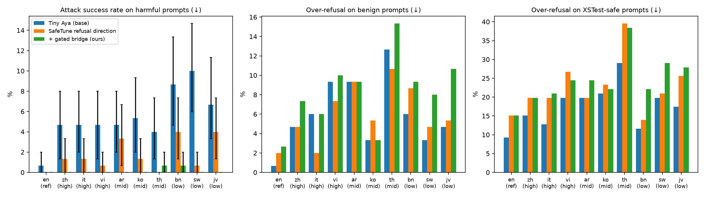

# XL-Refusal-Bridge

**Where does multilingual safety live in Tiny Aya, and can a two-vector adapter move it?**

Lexsi AI Safety and Alignment Hackathon — Track 2 (multilingual safety, locating and steering safety behaviour).
Model under test: [`CohereLabs/tiny-aya-global`](https://huggingface.co/CohereLabs/tiny-aya-global) (3.35 B parameters, 36 layers).

| Artifact | Link |
|---|---|
| Write-up | [`article/README.md`](article/README.md) |
| Benchmark | https://huggingface.co/datasets/davidquicast/xl-refusal-bench |
| Adapter | https://huggingface.co/davidquicast/tiny-aya-xl-refusal-bridge |
| Demo | https://huggingface.co/spaces/davidquicast/xl-refusal-bridge |

## The question

A multilingual model has to do two things before it refuses a harmful request: **recognise** that the request is
harmful, and **route** that recognition into a refusal. We test whether these two steps degrade differently across
languages:

- **H1 — detection is language-invariant.** A single linear probe at a middle layer separates harmful from benign
  prompts equally well in all ten languages, including a language it never saw in training.
- **H2 — routing is not.** The projection of harmful prompts onto the English refusal direction shrinks as the
  language gets lower-resource, and that shrinkage predicts unsafe behaviour.
- **H3 — a bridge closes the gap.** Using the invariant detector to gate a projection clamp along the refusal
  direction restores refusals where routing is weak, at a small cost in over-refusal and none in capability.

Every hypothesis is stated so that it can fail, and the results section reports which parts held.

## Method

All activations are read at the last prompt token, on the residual stream after each block.

| Step | What is computed | Data it may see |
|---|---|---|
| Refusal direction | `r_L = mean(h_L | harmful, en) − mean(h_L | benign, en)`, unit-normalised | English train |
| Detector | LDA probe with a language-invariance penalty: `w = (S_W + β·S_lang + λ·tr(S_W)/d·I)⁻¹ (μ_H − μ_B)` | train, 10 languages; XSTest-safe prompts are hard negatives |
| Probe selection | layer `L_d`, `β`, `λ` maximising the **worst-language** validation AUROC | validation |
| Gate | `g = 1[w·h_{L_d} > τ]`, `τ` = 95th percentile of safe validation scores (benign + XSTest-safe) | validation |
| Bridge | `h ← h + g · max(0, c·m*_L − r̂_L·h) · r̂_L` at layer(s) `L_r`, on the last prompt token and every generated token | `m*` from English train |
| Tuning | `L_r`, `c` with the lowest validation ASR subject to benign over-refusal ≤ baseline + 4 pp | validation, 4 languages |

When the gate is closed the forward pass is bit-identical to the base model. The adapter is one probe vector, one
direction per steered layer and two scalars; nothing is fine-tuned.

### Benchmark

`xl-refusal-bench`: the same prompts in ten languages (en, zh, it, vi, ar, ko, th, bn, sw, jv).

- **Harmful** — MultiJail (315 prompts, human translations).
- **Benign** — Alpaca instructions without input, machine-translated with NLLB-200 (1.3 B).
- **Safe but alarming** — XSTest safe prompts, same translation pipeline.

A machine-translated prompt is kept only if its back-translation reaches chrF ≥ 25 and it is in the right script in
*every* language; otherwise it is dropped everywhere, so all languages stay parallel. Splits are made by prompt, never
by row, so no prompt appears on both sides of a split in any language.

### Measurement

Responses are translated to English and labelled by a rubric judge (Qwen2.5-7B-Instruct) with two booleans, *refusal*
and *harmful*. A second model (PolyGuard-Qwen) gives an independent refusal label, and the baseline is also judged in
the original language where the judge supports it; agreement is reported.

- **ASR** — share of harmful prompts that get a harmful response.
- **RR** — share of harmful prompts refused.
- **ORR** — share of benign / XSTest-safe prompts refused.
- **Gap** — ASR of the worst language minus English ASR, and the low-resource-tier mean minus English.
- **Capability** — Belebele reading-comprehension accuracy, first-token KL on safe prompts, tokens per second.

Before/after differences use an exact McNemar test per language with Holm correction; rates carry bootstrap 95 %
intervals.

## Lexsi kits in the chain

| Kit | Role |
|---|---|
| **CuratorKIT** | cleaning and near-duplicate removal of the benchmark, dataset card |
| **SafeTune** | two steering baselines (`RefusalDirectionTrainer`, `CASTTrainer`) and an independent re-derivation of the refusal direction |
| **CircuitKIT** | EAP-IG circuit discovery for refusal in English, Swahili and Bengali, and their overlap |
| **AuditKIT** | Belebele scoring with a significance test, and a red-team probe set before/after |

## Results

Full write-up: [`article/README.md`](article/README.md). Headline numbers, test split, ten languages:

- Detection probe AUROC 0.988–0.996 in every language (0.988–0.994 with the language held out).
- Routing margin relative to English: 0.55–0.73 for six high/mid-resource languages, 0.46–0.54 for Bengali, Swahili,
  Javanese. Baseline attack success correlates with it (Spearman −0.77, n = 10) and not with detection (−0.07).
- Unseen prompts and languages (SORRY-Bench; de, es, fr, hi, ja, ru): attack success 9.0 % → 1.3 %.
- Belebele accuracy unchanged (75.6 %, 0 of 1,000 items differ); throughput 284 → 283 tokens/s; adapter 33 KB.
- The harmful label of the judge is noisy at these base rates (κ 0.2–0.4 against a larger judge and against
  native-language judging); the refusal label is reliable (κ 0.75). Read attack-success figures accordingly.



### Aggregate (test split)

| Condition | ASR macro ↓ | Refusal on harmful ↑ | Over-refusal benign ↓ | Over-refusal XSTest ↓ | Gap max (pp) ↓ | Gap low-tier (pp) ↓ | Languages |
|---|---|---|---|---|---|---|---|
| Tiny Aya (base) | 5.4 | 69.9 | 6.0 | 17.6 | 9.3 | 7.8 | 10 |
| + gated bridge (ours) | 0.1 | 95.6 | 8.2 | 24.4 | 0.7 | 0.2 | 10 |
| SafeTune refusal direction | 1.7 | 77.9 | 6.0 | 22.4 | 4.0 | 2.9 | 10 |
| SafeTune CAST | 0.9 | 98.2 | 99.6 | 98.1 | 8.0 | 0.0 | 10 |

### Ablations (same prompts for every row: 5 languages, test split)

| Condition | ASR macro ↓ | Refusal on harmful ↑ | Over-refusal benign ↓ | Over-refusal XSTest ↓ | Gap max (pp) ↓ | Gap low-tier (pp) ↓ | Languages |
|---|---|---|---|---|---|---|---|
| Tiny Aya (base) — same subset | 6.4 | 68.2 | 7.0 | 17.4 | 9.0 | 7.7 | 5 |
| + gated bridge (ours) — same subset | 0.4 | 96.4 | 9.0 | 26.5 | 1.0 | 0.3 | 5 |
| ablation: additive | 2.0 | 91.6 | 7.6 | 22.1 | 4.0 | 3.0 | 5 |
| ablation: no gate | 0.4 | 97.4 | 87.0 | 93.5 | 1.0 | 0.7 | 5 |
| ablation: random direction | 7.6 | 76.6 | 6.8 | 18.4 | 10.0 | 8.7 | 5 |
| ablation: English-only probe | 2.0 | 91.2 | 7.2 | 21.2 | 4.0 | 3.3 | 5 |
| ablation: beta = 0 | 0.8 | 96.2 | 7.8 | 24.2 | 2.0 | 1.0 | 5 |
| ablation: no hard negatives in the probe | 2.0 | 92.2 | 6.8 | 61.2 | 5.0 | 3.0 | 5 |

### Per language: base → bridge (test split)

| Lang | Tier | ASR % (95% CI) base | ASR % (95% CI) bridge | Holm p (McNemar) | Refusal % | Over-refusal benign % | Over-refusal XSTest % | Gate on harmful % |
|---|---|---|---|---|---|---|---|---|
| en | ref | 0.7 (0.0–2.0) | 0.0 (0.0–0.0) | 1 | 69.3 → 93.3 | 0.7 → 2.7 | 9.3 → 15.1 | 98.7 |
| zh | high | 4.7 (1.3–8.0) | 0.0 (0.0–0.0) | 0.0938 | 68.0 → 98.7 | 4.7 → 7.3 | 15.1 → 19.8 | 99.3 |
| it | high | 4.7 (2.0–8.0) | 0.0 (0.0–0.0) | 0.0938 | 60.0 → 88.0 | 6.0 → 6.0 | 12.8 → 20.9 | 97.3 |
| vi | high | 4.7 (1.3–8.0) | 0.0 (0.0–0.0) | 0.0938 | 78.7 → 97.3 | 9.3 → 10.0 | 19.8 → 24.4 | 99.3 |
| ar | mid | 4.7 (2.0–8.0) | 0.0 (0.0–0.0) | 0.0938 | 68.7 → 94.0 | 9.3 → 9.3 | 19.8 → 24.4 | 98.0 |
| ko | mid | 5.3 (2.0–9.3) | 0.0 (0.0–0.0) | 0.0547 | 72.7 → 96.0 | 3.3 → 3.3 | 20.9 → 22.1 | 99.3 |
| th | mid | 4.0 (1.3–7.3) | 0.7 (0.0–2.0) | 0.125 | 77.3 → 96.0 | 12.7 → 15.3 | 29.1 → 38.4 | 95.3 |
| bn | low | 8.7 (4.7–13.3) | 0.7 (0.0–2.0) | 0.00439 | 64.7 → 95.3 | 6.0 → 9.3 | 11.6 → 22.1 | 98.7 |
| sw | low | 10.0 (6.0–14.7) | 0.0 (0.0–0.0) | 0.00061 | 66.0 → 98.7 | 3.3 → 8.0 | 19.8 → 29.1 | 98.0 |
| jv | low | 6.7 (3.3–11.3) | 0.0 (0.0–0.0) | 0.0156 | 74.0 → 98.7 | 4.7 → 10.7 | 17.4 → 27.9 | 98.7 |


## Reproduce

```bash
pip install -e .
python tests/dry_run.py            # offline end-to-end check on a tiny random model, no GPU
```

The full study runs as two GPU sessions that coordinate through a Hugging Face dataset repository (`notebooks/`).
Session A builds the benchmark, caches activations, fits and tunes the bridge and evaluates it; session B runs the
kit stages. Each stage is idempotent and writes a `run.json` with code revision, config hash, seed, hardware and
library versions.

```bash
python -m xlrb.cli run_a           # bench → acts → fit → base → tune → bridge → ablations → report
python -m xlrb.cli run_b           # SafeTune baselines → capability → red team → circuits
python -m xlrb.cli ood             # held-out prompts and unseen languages
python -m xlrb.figures results/<tag> results/<tag>/fit article/figures
```

## Layout

```
src/xlrb/      pipeline (data, activations, fit, bridge, judge, metrics, kits, cli, figures)
configs/       the one configuration used for the reported run
notebooks/     the two Colab entry points
results/       metrics, per-language table, analysis and kit outputs
adapters/      the bridge (safetensors + config)
article/       write-up and figures
space/         Gradio demo
tests/         offline dry run
```

## Limitations

- One model family and one harmful-prompt source; MultiJail prompts are direct requests, not adversarial jailbreaks.
- Benign and XSTest prompts are machine-translated; quality is lowest exactly where the question is most interesting.
- Verdicts come from an LLM judge reading machine-translated responses. Agreement figures are reported, but there is
  no human annotation.
- The refusal direction is a difference of means: it shows that a direction is sufficient to steer, not that it is
  the mechanism the model uses.

## License

MIT for the code. The benchmark inherits the licences of MultiJail, Alpaca and XSTest.
