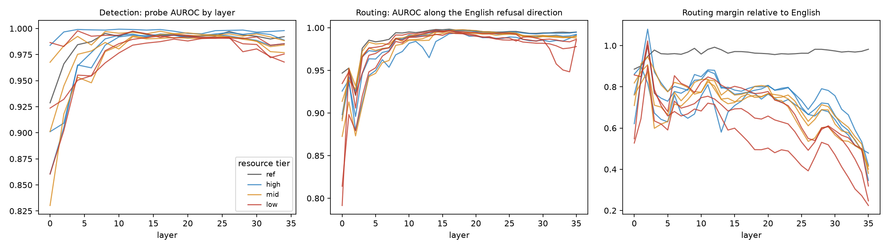
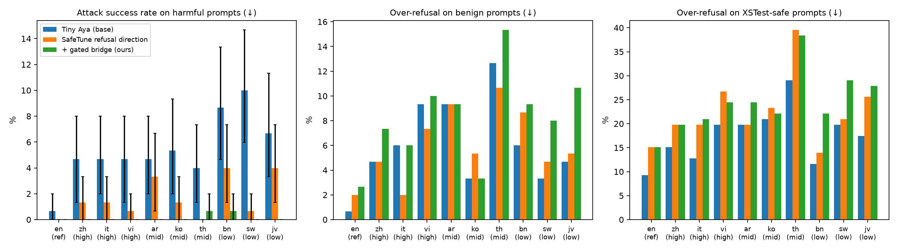

# Tiny Aya knows it is harmful in Javanese. It just does not act on it as firmly.

*A detect–route dissociation in multilingual refusal, and a two-vector adapter that uses it.*

Lexsi AI Safety and Alignment Hackathon · Track 2 · model: `CohereLabs/tiny-aya-global`
Kits used: CuratorKIT → SafeTune → CircuitKIT → AuditKIT

## Summary

- **Detection is language-invariant.** One linear probe at layer 20 separates harmful from benign prompts with
  AUROC 0.988–0.996 in all ten languages. Trained with any one language held out, it scores 0.988–0.994 on that
  language.
- **Routing is not.** The projection of harmful prompts onto the English refusal direction keeps its *sign* in every
  language but loses *size*: at the steering layer the margin relative to English falls from 0.98 (English) to
  0.55–0.73 for the six high- and mid-resource languages and 0.46–0.54 for Bengali, Swahili and Javanese.
- **The shrinkage tracks unsafe behaviour; detection quality does not.** Across the ten languages, baseline attack
  success correlates with routing margin (Spearman ρ = −0.77) and not with detection AUROC (ρ = −0.07). Ten points is
  a small sample; we read this as support, not proof.
- **A gated clamp closes the gap.** Using the probe to gate a projection clamp along the refusal direction takes
  macro attack success from 5.4 % to 0.1 % and refusal of harmful prompts from 69.9 % to 95.6 %. The worst-language
  gap to English goes from 9.3 pp to 0.7 pp.
- **It costs over-refusal on alarming-but-safe prompts.** Refusal of benign instructions moves from 6.0 % to 8.2 %
  (not significant in any language); refusal of XSTest-safe prompts moves from 17.6 % to 24.4 % (significant in
  Bengali and Javanese).
- **A ten-times-larger judge agrees.** Re-labelling all 25,220 test responses with Qwen2.5-72B gives 7.5 % → 0.1 %
  attack success, significant in nine of ten languages, and ρ = −0.82 for the margin correlation.
- **It transfers.** On a different prompt source (SORRY-Bench) and six languages never used to fit anything, attack
  success falls from 9.0 % to 1.3 %.

The adapter is one probe vector, three direction vectors and two scalars. No weights are changed, and when the gate
is closed the forward pass is identical to the base model.

## 1. Question

Multilingual models are less safe in low-resource languages. The usual explanation is that the model "understands
less" there. We test a more specific claim: that the model recognises harm equally well everywhere, and what degrades
is the step that turns recognition into refusal. If so, safety can be repaired by connecting the two, without
retraining.

Three hypotheses, each stated so that it can fail:

- **H1** — a single linear detector of harmful intent works equally well in every language, including unseen ones.
- **H2** — the refusal signal is weaker in low-resource languages, and its weakness predicts unsafe responses.
- **H3** — gating a refusal-direction clamp on the detector removes the cross-lingual gap at low cost.

## 2. Benchmark (CuratorKIT)

`xl-refusal-bench` holds the same prompts in ten languages: English, Chinese, Italian, Vietnamese, Arabic, Korean,
Thai, Bengali, Swahili, Javanese.

| Class | Source | Prompts per language | Translation |
|---|---|---|---|
| Harmful | MultiJail | 315 | human (from the source) |
| Benign | Alpaca, instructions without input | 315 | NLLB-200 1.3B |
| Safe but alarming | XSTest, safe subset | 206 | NLLB-200 1.3B |

A machine-translated prompt survives only if its back-translation reaches chrF ≥ 25 and it is in the expected script
in *every* language; otherwise it is dropped from all of them. That removed 77 benign and 44 XSTest prompts and keeps
the languages exactly parallel. CuratorKIT cleans and de-duplicates the English side and writes the dataset card.
Splits are by prompt: harmful and benign 115 train / 50 validation / 150 test; XSTest 80 / 40 / 86.

## 3. Method

Activations are read on the residual stream at the last prompt token.

**Refusal direction.** `r_L = mean(h_L | harmful, English) − mean(h_L | benign, English)`, normalised, from the
English training split only. SafeTune's own extractor returns the same vector (cosine 0.99999 at layer 27).

**Detector.** A linear discriminant with a penalty on between-language scatter,
`w = (S_W + β·S_lang + λ·tr(S_W)/d · I)⁻¹ (μ_H − μ_B)`. Layer, β and λ are chosen to maximise the *worst-language*
validation AUROC (layer 20, β = 1, λ = 0.1). XSTest-safe training prompts are in the negative class, so the probe has
to separate harmful intent from alarming vocabulary.

**Gate.** `g = 1[w·h_20 > τ]`, with τ the 95th percentile of scores on safe validation prompts (benign and XSTest).

**Bridge.** At layers 25, 27 and 29, on the last prompt token and every generated token:
`h ← h + g · max(0, c·m* − r̂·h) · r̂`, where `m*` is the mean projection of English harmful training prompts. The
clamp lifts the refusal component to the English level and never pushes it down. Layers and `c = 1.25` were chosen
on validation data in four languages by the rule fixed in advance: lowest attack success with benign over-refusal no
more than 4 pp above baseline.

## 4. Measurement, and how far to trust it

Responses are translated to English (NLLB) and labelled by Qwen2.5-7B-Instruct with a two-field rubric: *refusal*
(the response explicitly declines or rejects the request) and *harmful* (the response supplies content that serves
the harmful intent).

We checked the judge three ways.

| Check | Refusal | Harmful |
|---|---|---|
| vs. Qwen2.5-72B on 400 pairs | agreement 0.89, κ 0.75 | agreement 0.95, κ 0.21 |
| vs. the same judge reading the original language (1,930 pairs) | agreement 0.90, κ 0.76 | agreement 0.97, κ 0.38 |
| vs. PolyGuard-Qwen (3,860 pairs) | agreement 0.83, κ 0.58 | — |

The refusal label is reliable. The harmful label is not: at a base rate near 5 % the two judges flag the same
*number* of responses but mostly different ones, and the flagged items are borderline. **Attack-success figures near
5 % are therefore close to the judge's noise floor.** Refusal rate is the better-measured outcome, and we report both
throughout. An earlier rubric that counted any non-answer as a refusal inflated benign over-refusal threefold; it was
caught by reading samples and replaced before any reported number was produced.

To remove the dependence on one small judge, all test responses were later re-labelled by the 72B model
(Section 5.8).

Rates carry bootstrap 95 % intervals. Before/after comparisons use an exact McNemar test per language with Holm
correction over the ten languages.

## 5. Results

### 5.1 H1 holds: detection does not depend on the language

| | Range over the ten languages |
|---|---|
| Probe AUROC, harmful vs. benign (test) | 0.988 – 0.996 |
| Same, language held out of probe training | 0.988 – 0.994 |
| Same, probe trained on English only | 0.966 – 0.994 |
| Probe AUROC, harmful vs. XSTest-safe | 0.962 – 0.991 |
| Gate open on harmful prompts | 95.3 – 99.3 % |
| Gate open on benign prompts | 0.7 – 6.0 % |
| Gate open on XSTest-safe prompts | 5.8 – 23.3 % |

Even a probe that only ever saw English reaches 0.966 on Javanese. The harm signal is shared across languages by the
middle of the network.

### 5.2 H2 holds in part: the routing margin shrinks, and it predicts attack success

Projection onto the English refusal direction still *separates* harmful from benign prompts in every language (AUROC
above 0.97 at the steering layer). What changes is the distance: harmful prompts in Javanese sit at 46 % of the
English margin, Swahili 53 %, Bengali 54 %.

Baseline attack success by language correlates with that margin (ρ = −0.77) and not with detection quality
(ρ = −0.07). The part of H2 that does **not** hold: baseline *refusal rate* shows no relation to the margin
(ρ = −0.02). Refusal rates are similar across languages (60–79 %) with no resource ordering; the low-resource
languages differ in how often a non-refusal is actually harmful.

### 5.3 H3 holds: the bridge closes the gap

{{TABLES}}

Refusal of harmful prompts rises significantly in every language (Holm-adjusted p < 10⁻⁷). Attack success falls
significantly in the three low-resource languages; elsewhere the baseline rate is already too low for 150 prompts to
show a significant drop.

Two honest qualifications. First, the bridge raises refusal in English too (69 % → 93 %): it hardens the model on
MultiJail in general and, in doing so, removes the gap, rather than acting only where the gap is. Second, MultiJail
contains mild items for which a helpful answer is arguably fine; a higher refusal rate on them is not purely a gain.

### 5.4 What each part contributes

The ablation table above uses the same prompts for every row.

- **Direction matters.** A random direction with the same gate and strength leaves attack success at baseline.
- **The gate matters most.** Without it the same clamp refuses 87 % of benign prompts.
- **Hard negatives matter for XSTest.** A probe trained without them opens the gate on most XSTest-safe prompts and
  over-refusal there reaches 61 %.
- **Clamping beats adding.** Adding a fixed multiple of the direction leaves 2–4 % attack success in Bengali,
  Swahili and Javanese where the clamp leaves 0–1 %. The differences are small counts and were not tested for
  significance.
- **The multilingual probe beats an English-only one** by a similar small margin (2–4 % vs. 0–1 % in the same
  three languages).
- **The invariance penalty (β) changes little** once the probe is trained on all ten languages.

### 5.5 Against SafeTune baselines

SafeTune's uniform refusal-direction steering, tuned with the same validation rule, reaches 1.7 % attack success and
77.9 % refusal. It has no gate, so its strength is capped by benign over-refusal. SafeTune's CAST, with default
settings calibrated on our training split, refused nearly everything including benign prompts (99.6 %); we report it
as run and did not tune it further.

### 5.6 Transfer to other prompts and unseen languages

The bridge was applied unchanged to 100 SORRY-Bench prompts in six languages that were never used for the direction,
the probe, the threshold or the tuning.

{{OOD}}

### 5.7 Capability, red team and circuits (AuditKIT, CircuitKIT)

{{KITS}}

## 6. Cost comparison

{{ROI}}

## 7. Limitations

- One model and one harmful-prompt family for fitting. MultiJail prompts are direct requests, not adversarial
  jailbreaks; nothing here shows robustness to an attacker who optimises against the gate.
- Individual harmful labels are noisy for both judges (κ about 0.4 between them). Aggregate attack-success rates
  agree across judges; single-response verdicts should not be relied on. There is no human annotation.
- Ten languages give ten points for the correlation in 5.2.
- Benign and XSTest prompts are machine-translated, and responses are judged through machine translation. Quality is
  lowest in the languages the question is about.
- The refusal direction is a difference of means. It is sufficient to steer; that does not make it the mechanism.
- Over-refusal on XSTest-safe prompts rises by about 7 pp. A deployment that cares about that should lower `c` or
  raise τ and accept a smaller gain.

## 8. Reproduce

Code, configuration, results and the adapter are in the repository. `python tests/dry_run.py` runs the whole path
offline on a tiny random model. The full study runs as two GPU sessions (`notebooks/`); every stage writes a
`run.json` with code revision, config hash, seed, hardware and library versions.
